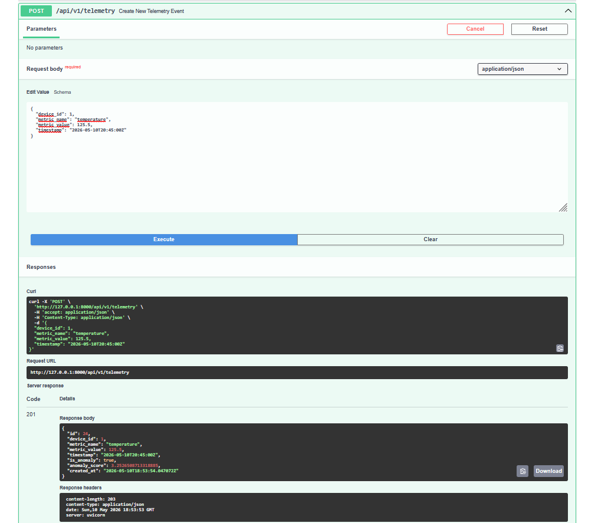

# Real-Time IoT Anomaly Detection System

Real-time event-driven IoT monitoring platform with live anomaly detection and streaming telemetry dashboards.

---

## Dashboard


## API Documentation



---

## Features

- Real-time telemetry ingestion
- MQTT event streaming
- Live WebSocket dashboard
- Machine learning anomaly detection
- Async FastAPI backend
- PostgreSQL persistence
- Typed Python codebase
- REST API with OpenAPI documentation
- Modular service-oriented architecture
- Automated testing with pytest
- Static analysis with Ruff and mypy

---

## Architecture

```text
IoT Devices / Simulator
        |
        v
     MQTT Broker
        |
        v
 Ingestion Worker
        |
        +--> PostgreSQL
        |
        +--> WebSocket Broadcast
                    |
                    v
           Real-time Dashboard
```

---

## Tech Stack

### Backend

- Python
- FastAPI
- SQLAlchemy Async
- PostgreSQL
- MQTT (Mosquitto)
- WebSockets
- scikit-learn

### Frontend

- React
- TypeScript
- TailwindCSS
- Recharts
- Vite

### Tooling

- Docker Compose
- pytest
- Ruff
- mypy

---

## Project Structure

```text
app/
├── api/
├── core/
├── db/
├── mqtt/
├── repositories/
├── schemas/
├── services/
├── websockets/
└── main.py

frontend/
tests/
scripts/
```

---

## Getting Started

### Clone repository

```bash
git clone <your_url_repo>
cd real-time-iot-anomaly-detection
```

### Create virtual environment

```bash
python -m venv .venv
```

### Activate virtual environment

Windows PowerShell

```powershell
.venv\Scripts\Activate.ps1
```

Linux/macOS

```bash
source .venv/bin/activate
```

### Install backend dependencies

```bash
pip install -e ".[dev]"
```

### Start infrastructure

```bash
docker compose up -d
```

### Run backend

```bash
uvicorn app.main:app --reload
```

Backend available at:

```text
http://127.0.0.1:8000
```

Swagger documentation:

```text
http://127.0.0.1:8000/docs
```

### Run frontend

```bash
cd frontend
npm install
npm run dev
```

Frontend available at:

```text
http://localhost:5173
```

---

## Running Tests

```bash
pytest -v
```

---

## Current API Endpoints

| Method | Endpoint | Description |
| --- | --- | --- |
| GET | `/api/v1/health` | Health check |
| POST | `/api/v1/devices` | Create device |
| GET | `/api/v1/devices` | List devices |
| GET | `/api/v1/devices/{device_id}` | Get device |
| GET | `/api/v1/devices/{device_id}/telemetry` | Device telemetry |
| POST | `/api/v1/telemetry` | Create telemetry event |
| GET | `/api/v1/telemetry` | List telemetry events |
---

## Example Use Cases

- Industrial IoT monitoring
- Smart building telemetry
- Predictive maintenance
- Environmental sensor monitoring
- Edge telemetry analysis
- Real-time alerting systems
---

## Future Improvements

- Redis event bus
- Kafka integration
- Advanced ML models
- Authentication & RBAC
- Multi-device dashboards
- Historical analytics
- Prometheus & Grafana observability
- Kubernetes deployment
---

## License

MIT